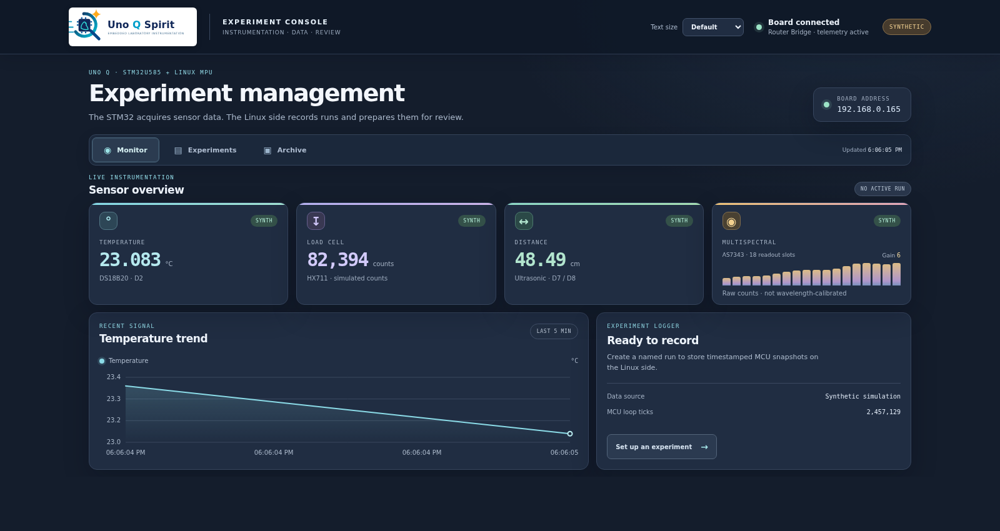

# UNO Q Spirit
## User's & Programmer's Guide

**Instrumentation Verification Suite · Engineering preview 0.1.1**  
**Guide revision:** 1.0 · **25 October 2026**  
**Platform:** Arduino UNO Q · STM32U585 + Linux MPU

> **A practical starting point for a software-defined physical laboratory.** This guide explains the instrument that exists today, how to operate it, how its software fits together, and what remains an ambition.


**Project status:** the software has been built and exercised with synthetic data. The original 5 V Spirit shield is not electrically qualified for UNO Q. Physical sensor measurements, calibration, and autonomous experimentation are not claimed as complete.

---

## 1. What we are building

UNO Q Spirit is an educational instrumentation project for connecting physical sensors to experiments that can be configured, observed, recorded, and reviewed in software. It is also a first instrument within the broader **Software-Defined Laboratory** idea: laboratory behavior should be described and controlled by software, while hardware provides safe, measurable access to the physical world.

The immediate design preserves the Spirit shield's educational sensor mix—temperature, load, distance, and spectral light—while moving acquisition to the UNO Q's STM32 microcontroller and moving the operator interface, archive, and experiment logic to Linux. The system deliberately begins in synthetic mode so the software interface can be exercised before sensor wiring is qualified.

### What is implemented now

| Capability | Current implementation |
|---|---|
| MCU acquisition program | Arduino sketch for UNO Q; synthetic startup; live sensor paths for DS18B20, HX711, HC-SR04-style ultrasonic, and AS7343 |
| Board communication | Router Bridge RPC methods `spirit.status` and `spirit.command` |
| Operator control | Python command-line console, interactive shell, and CSV capture |
| Experiment dashboard | Browser UI with Monitor, Experiments, and Archive tabs; dark branded theme; selectable text size |
| Experiment records | Linux-side SQLite archive with operator notes, timestamps, sensor snapshots, and per-run CSV download |
| Sensor-only spectral bring-up | Separate AS7343 test sketch; checks UNO Q Qwiic `Wire1` first, then header `Wire` on D20/D21 |

### What remains a goal

The current instrument does not automatically design experiments, choose interventions, calibrate itself, or certify safety. Those are future capabilities. Today it gives a human operator a working interface around a microcontroller, a Bridge connection, telemetry, and a local record archive. The electrical behavior of the legacy Spirit hardware and physical sensor accuracy still need bench validation.

## 2. System architecture

UNO Q has two computing sides. The **STM32U585 MCU** runs the Arduino sketch and owns GPIO timing and sensor acquisition. The **Linux MPU** runs Python, provides network access, stores experiment records, and serves the dashboard. The Router Bridge passes status and commands between them.

```text
 Physical sensors                     Operator's Chrome browser
        │                                         │
        ▼                                         ▼
 ┌────────────────────┐      Bridge       ┌───────────────────────┐
 │ STM32U585 MCU       │◄────────────────►│ Linux MPU              │
 │ Arduino sketch      │ spirit.status     │ Python CLI             │
 │                    │ spirit.command    │ Dashboard HTTP :7000   │
 │ • sample + validate │                  │ SQLite experiment log  │
 │ • state + counters  │                  │ CSV export              │
 │ • synthetic mode    │                  └───────────────────────┘
 └────────────────────┘
```

The direction matters. The MCU continues acquisition locally; the Linux side consumes telemetry and handles experiment workflow. Dashboard Start and Stop begin and end **Linux-side recording**. They do not enable live sensors, change the MCU profile, or stop the MCU loop. Sensor mode and profile changes are explicit CLI or RPC commands.

The code is organized around that split:

- `UNO_Q_Spirit/UNO_Q_Spirit.ino` — pin map, startup mode, sensor schedules, state handling, JSON contract, and Bridge providers.
- `UNO_Q_Spirit/filters.h` — small pure functions for signed HX711 values, distance conversion, interval bounds, and running statistics.
- `python/spirit_cli.py` — CLI transport, schema checks, commands, mock mode, and command-line CSV capture.
- `python/dashboard_server.py` — Bridge sampler, experiment API, SQLite writer, and dashboard static-file service.
- `dashboard/` — browser presentation, chart, operator feedback, accessibility controls, and local assets.
- `examples/as7343-qwiic-test/` — standalone sensor test that does not depend on the Spirit shield or Bridge.

The [Code Review Guide](CODE_REVIEW_GUIDE.md) gives a file-by-file reading path and describes important code contracts.

## 3. Getting started as an operator

### Open the dashboard

The current dashboard address is **http://192.168.0.165:7000** when the UNO Q and browser are on the same network. On the UNO Q, from the project directory, start it with:

```bash
source /home/arduino/.venvs/uno-q-spirit/bin/activate
python python/dashboard_server.py
```

The process must be able to access the local Router Bridge socket. The `arduino` account was added to the `arduino-router` group for this installation. A newly started login session receives that membership; a shell opened before the change may need its group refreshed or a new login.

The service listens on port 7000 and binds to all network interfaces by default. It uses plain HTTP and has no login screen; keep it on a trusted local network. It currently runs in the foreground, so closing that shell stops the dashboard. Boot-time service management has not been configured.

### Read the Monitor tab

The Monitor tab shows connection state, MCU mode, temperature, load-cell counts, distance, and AS7343 readout slots. The trend chart keeps recent valid temperature points. Missing and faulted values are shown as state labels and blanks rather than being presented as real zero readings. The Synthetic badge means the values are generated by firmware for interface development and are not sensor observations.

Use the **Text size** selector in the header for Default, Larger, or Largest text. Your selection is saved in that browser. The temperature chart and sensor cards retain their layout as text scales.

### Record an experiment

1. Open **Experiments** and give the run a descriptive name.
2. Select the snapshot interval. The allowed range is 1 second through 1 hour; the default is 3 seconds.
3. Add notes about setup, sample, illumination, or other conditions that will matter later.
4. Start recording. The dashboard confirms the run name and shows the active run and sample count.
5. Stop the run when complete. The dashboard confirms that the record was saved.
6. Open **Archive** and download that run's CSV.

The dashboard records snapshots from the MCU's reported telemetry. Recording a synthetic run is useful for checking controls, archive behavior, and CSV output; it is not a substitute for an experiment with qualified sensors.

### Use the command-line console

The CLI offers the same board status and configuration controls for terminal workflows:

```bash
python python/spirit_cli.py status
python python/spirit_cli.py shell
python python/spirit_cli.py capture --count 30 --period 2 --output run.csv
```

In the interactive shell, `help` lists commands. Common examples:

```text
spirit> status
spirit> profile prototype
spirit> mode live
spirit> gain 6
spirit> tare
spirit> start
spirit> stop
spirit> mode synthetic
```

The direct CLI also accepts commands such as `python python/spirit_cli.py profile prototype`. Python `--mock` mode generates host-only telemetry without connecting to the board:

```bash
python python/spirit_cli.py --mock status
python python/spirit_cli.py --mock capture --count 10 --period 0.2 --output mock.csv
```

The mock and MCU synthetic modes are separate mechanisms. Neither one is evidence of live sensor readings.

## 4. Dashboard and experiment data

The dashboard has three tabs:

- **Monitor** — connection and mode, sensor state cards, spectral bars, temperature trend, and run summary.
- **Experiments** — name, interval, notes, start/stop controls, and operator feedback.
- **Archive** — saved runs, sample counts, mode-at-start, and CSV links.

The browser polls `/api/state`. The server polls the Bridge approximately once per second. While a run is active, the server stores a snapshot at the operator-selected interval in:

```text
~/.local/share/uno-q-spirit/experiments.sqlite3
```

Set `SPIRIT_DATA_DIR` to choose another archive directory. Each CSV includes UTC timestamps; mode and profile; temperature, load, and distance state/value pairs; HX711 calibration status; spectral state, gain and 18 raw slots; and MCU loop ticks. The 18 spectral slots are raw driver readouts, **not calibrated wavelength bins**.

Useful HTTP routes for support and integration are `GET /healthz`, `GET /api/state`, `GET /api/runs`, `POST /api/runs`, `POST /api/runs/stop`, and `GET /api/runs/<run-id>/csv`. Experiment endpoints do not provide arbitrary MCU command access.



*This interface capture uses synthetic telemetry, clearly marked as such; it illustrates the dashboard and is not a physical sensor dataset.*

## 5. Hardware paths and sensor safety

### Spirit-oriented sensor set

The historical pin contract and the current prototype wiring are not the same on every bus. The current Spirit sketch's default Arduino `Wire` is on UNO Q **D20 (SDA) / D21 (SCL)**. It does not use the historic Spirit board's A4/A5 I²C assignment by default.

| Sensor/function | Current connection | Notes |
|---|---|---|
| DS18B20 | D2 | Externally powered 3-wire mode; use a 4.7 kΩ pull-up to 3.3 V unless the verified module already includes it |
| HX711 DOUT / SCK | D3 / D4 | Live acquisition in `profile all`; calibration is RAM-only |
| START / TARE buttons | D5 / D6 | Optional active-low inputs |
| Ultrasonic TRIG / ECHO | D7 / D8 | ECHO must be 3.3 V compatible or safely level shifted |
| Buzzer module signal | D9 | Active buzzer module signal; not a raw speaker output |
| AS7343 on default `Wire` | D20 / D21 | Breakout I²C for the Spirit sketch's standard profile |

`profile prototype` enables only DS18B20 and AS7343 for live acquisition and disables HX711 and ultrasonic polling. It does **not** mean AS7343-only mode. Start in synthetic mode; switch to live only after checking the actual wiring and voltage domain.

### Standalone spectrometer path

For optical-sensor bring-up without Spirit hardware, compile `examples/as7343-qwiic-test/as7343-qwiic-test.ino`. It checks the UNO Q's 3.3 V Qwiic connector (`Wire1`) first, then falls back to the ordinary D20/D21 header (`Wire`). Connect the Adafruit AS7343 breakout using either a STEMMA QT/Qwiic cable or four jumper wires. The sketch reports the bus it found and prints a CSV-like row every two seconds through Serial Monitor at 115200 baud.

This is a direct communication and relative-response check. The breakout is a multispectral light sensor, not a calibrated scanning spectrometer; actual wavelength response and measurement fidelity require references and controlled optical conditions. The standalone sketch has compiled for UNO Q, but the sensor has not been physically tested in this validation record.

### Electrical no-go

**Do not connect the unmodified historical 5 V Spirit shield directly to the UNO Q.** In particular, the historical HC-SR04 ECHO path is documented as unshifted 5 V. The original board's rails, pull-ups, connector orientation, and any 5 V sources must be audited before it is attached. Use the [Pins & Safety](PINS_AND_SAFETY.md) guide and the [prototype quickstart](PROTOTYPE_SHIELD_QUICKSTART.md); power down while changing initial wiring.

## 6. Programmer's guide

### Build the main firmware

For an installed UNO Q core and dependencies:

```bash
arduino-cli compile --fqbn arduino:zephyr:unoq UNO_Q_Spirit
```

The recorded deployment used Arduino CLI 1.5.1, UNO Q Arduino Zephyr core 1.0.0, and ARM Zephyr GCC 14.3.0. The firmware was compiled and uploaded to the UNO Q at `192.168.0.165`; it booted in synthetic mode and answered Bridge status requests. Build logs and exact package inventory are in [Validation](VALIDATION.md).

Libraries used by the main sketch include Arduino_RouterBridge, OneWire, Adafruit AS7343, and its Adafruit BusIO dependency. For the exact installed commands, see [Build & Run](BUILD_AND_RUN.md). An actual board-core build is stronger evidence than the host mock; neither establishes electrical safety or sensor accuracy.

### Build the standalone AS7343 sketch

```bash
arduino-cli compile --fqbn arduino:zephyr:unoq examples/as7343-qwiic-test
```

The latest recorded compile passed and used 106,076 bytes of flash and 44,048 bytes of RAM. It was not uploaded as a sensor test because no AS7343 was attached during that build check.

### Understand the Bridge contract

The MCU registers `spirit.status` and `spirit.command`. Python calls them by these exact names. Status returns a JSON string with schema version 1. A representative shape is:

```json
{
  "schema": 1,
  "mode": "synthetic",
  "profile": "all",
  "bridge_ok": true,
  "temp_c": {"state": "SYNTH", "value": 22.1, "ok_count": 10, "error_count": 0},
  "spectral": {"state": "SYNTH", "gain_code": 6, "channels": [512, 430, 390, 620, 700, 560, 430, 380, 220, 190, 180, 170, 100, 90, 80, 70, 60, 50]}
}
```

The channel numbers above are illustrative only. Real responses contain an 18-element integer array. Sensor `value` is null when a reading is not valid for its state. Consumers should check `schema`, state labels, and channel count rather than assuming a sensor succeeded.

Commands are one string per RPC, including `mode synthetic`, `mode live`, `profile prototype`, `profile all`, `start`, `stop`, `tare`, `gain 0..12`, `interval 100..10000`, `reset-stats`, and `cal grams <known mass>`. The sketch returns `{ "ok": false, "error": "..." }` for rejected commands. A successful calibration stores counts-per-gram in volatile RAM; it is lost when the MCU resets or mode/profile changes.

### Acquisition and interpretation

The main sketch defaults to synthetic mode and does not probe attached sensors until explicitly put into live mode. In live mode, temperature conversion is initiated and completed asynchronously; HX711 checks readiness before a bounded transfer; ultrasonic echo waits are capped; missing sensors are retried. AS7343 uses an Adafruit driver whose synchronous channel-read can wait up to about one second, so the complete loop is not hard-real-time verified.

Important data semantics:

- `SYNTH` values are simulation output, not sensor measurements.
- `MISSING`, `TIMEOUT`, `FAULT`, `WARMUP`, `DISABLED`, and `SATURATED` are meaningful states, not ordinary values.
- HX711 counts are not grams until a known mass has been used to calibrate after tare. Calibration is not persistent.
- Distance is estimated in centimeters with a temperature compensation model; physical accuracy has not been characterized.
- AS7343 values are raw readout slots and gain metadata, not calibrated optical power.
- Dashboard recording interval controls Linux snapshot cadence. Firmware sensor polling periods are separate.

## 7. Verification record and limitations

The project includes Python unit tests, pure C++ filter tests, and a host-compiled Arduino sketch using stubs. The actual UNO Q main firmware was built, uploaded, and observed returning synthetic telemetry through the local Router Bridge. A sample CLI capture and dashboard recording/export flow were exercised. Dashboard start/stop feedback, archive listing, and CSV delivery were checked in a browser.

The standalone AS7343 example compiles with the UNO Q board core. No physical AS7343 has been attached and verified in the recorded check. No real DS18B20, HX711, or ultrasonic measurements have been characterized in this guide's validation evidence. Host tests prove software logic under fixtures; they do not prove the MCU's electrical timing or real peripheral behavior.

For reproducible checks, see [Test Plan](TEST_PLAN.md) and [Validation](VALIDATION.md). Preserve the distinction between **compiled**, **uploaded**, **synthetic smoke-tested**, and **physically measured** when documenting new evidence.

## 8. From instrument console to software-defined laboratory

The wider ambition is a reusable laboratory stack in which a human—or eventually an approved autonomous agent—can describe an experiment, select compatible instruments, configure safe operating limits, collect evidence, and review reproducible results.

| Stage | Direction | What it would add |
|---|---|---|
| **1 · Instrument** | Current foundation | MCU acquisition, stable telemetry schema, command validation, explicit synthetic/live states |
| **2 · Experiment record** | Implemented first workflow | Named run, notes, sampling interval, UTC data, durable archive, CSV export |
| **3 · Reproducible procedure** | Next design work | Versioned experiment definitions, calibration references, hardware/software provenance, preflight checks |
| **4 · Lab orchestration** | Future | Coordinated instruments and actuators, scheduled workflows, resource and interlock management |
| **5 · Bounded autonomy** | Long-term ambition | Machine-proposed or machine-run experiments within operator-approved limits, with traceable decisions and a human review loop |

Progress toward autonomy must preserve a clear chain from an experiment definition to the commands issued, measurements observed, calibration state, and exported result. Safety limits and hardware interlocks must be enforceable below the language-model or dashboard layer. An attractive interface is valuable, but it does not replace verified circuitry, independent cutoffs, calibration, or experimental controls.

## 9. Glossary and project references

| Term | Meaning in this project |
|---|---|
| MPU | UNO Q's Linux application processor; runs Python services, dashboard, and storage |
| MCU | STM32U585; runs the Arduino sketch and local acquisition loop |
| Router Bridge | RPC path between Linux and the MCU |
| `Wire` | UNO Q's default Arduino I²C bus on D20/D21 |
| `Wire1` | UNO Q's separate Qwiic I²C bus |
| STEMMA QT / Qwiic | Four-pin I²C cable/connector family used by compatible breakouts |
| Synthetic mode | Generated telemetry for software bring-up; not physical data |
| Profile | Runtime choice of sensor acquisition set; `prototype` and `all` |
| Run | Linux-side metadata and snapshots stored in the SQLite archive |

Further reading: [Project README](../README.md) · [Build and run](BUILD_AND_RUN.md) · [Dashboard and API](DASHBOARD.md) · [Code review guide](CODE_REVIEW_GUIDE.md). For bench work, see the [prototype-shield quickstart](PROTOTYPE_SHIELD_QUICKSTART.md), [safety and pin contract](PINS_AND_SAFETY.md), [test plan](TEST_PLAN.md), and [validation evidence](VALIDATION.md).

---

*UNO Q Spirit is an engineering preview. Arduino, Zephyr, Adafruit, and other vendor names identify compatible platforms or components; this project is not affiliated with those vendors.*
